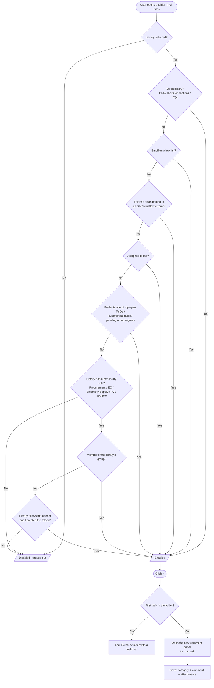
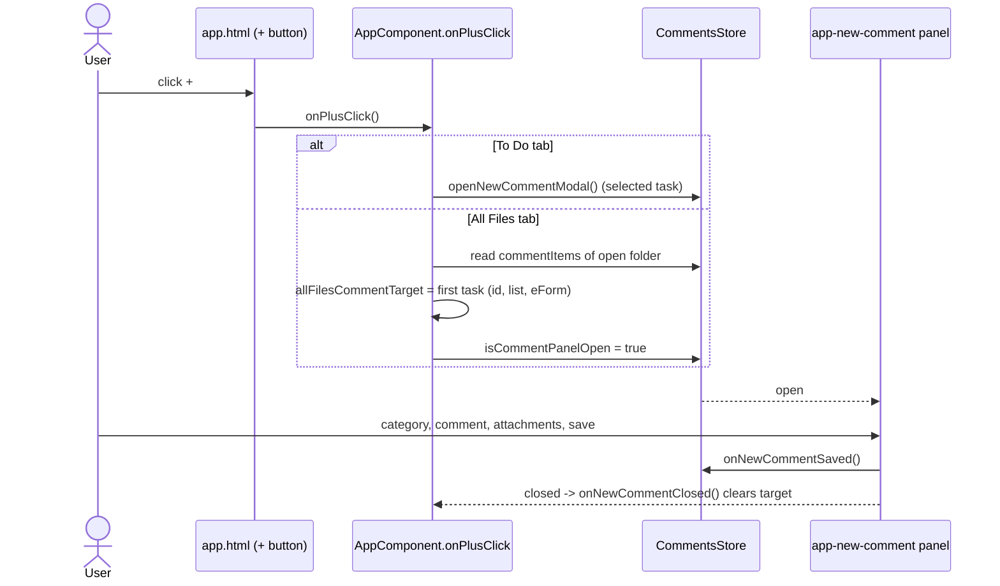

# All Files — "New Comment" (+) button

The **+** in the Comments card header works on both the **To Do** and **All Files** tabs and opens the same
new-comment panel (category, comment, attachments). On All Files it is **greyed out and unclickable** unless the
user is allowed to comment on the open file. The rules mirror the Power Apps `ico_NewComment` `DisplayMode` formula.

## Where things live

| What | File |
|---|---|
| The button, its disabled state | `my-app/src/app/app.html` (Comments card header, `plus-btn`) |
| Rules (`canAddOnAllFiles`, `allFilesPlusReason`) and click handler (`onPlusClick`) | `my-app/src/app/app.ts` |
| Open libraries, group ids, per-library rules, email allow-list | `my-app/src/app/hr-task-lists.config.ts` |
| User's group memberships (`groupIds`) | `my-app/src/app/stores/session.store.ts` |
| Open folder's `assignedTo` / `createdBy` | `my-app/src/app/stores/all-files.store.ts` |
| To Do tasks (`currentTasks`) | `my-app/src/app/services/todo.service.ts` |
| Greyed-out styling (`.plus-btn--disabled`) | `my-app/src/app/app.css` |

## When is the + enabled on All Files?

`allFilesPlusReason()` checks the rules in this order and stops at the first match. If none matches, the button
is disabled. Nothing selected yet is always disabled.

| # | Rule | Power Apps rule |
|---|---|---|
| 1 | **Open library** — `CFADocumentLibrary`, `IllicitConnectionsDocumentLibrary`, `TDIDocumentLibrary` (exact library name) | 5, 7, 8 |
| 2 | **Allow-listed email** — in `ALL_FILES_PLUS_ALLOWED_EMAILS` | 13 |
| 3 | **SAP workflow** — one of the open folder's tasks belongs to an eForm flagged SAP workflow | 4 |
| 4 | **Assigned to me** — the folder's `assignedTo` is the signed-in user (email or display name) | 1 |
| 5 | **In my To Do** — the folder name equals the name of one of my To Do tasks (own and subordinates'), and that task is still **pending or in progress** (not completed/rejected) | 1 |
| 6 | **Per-library rules** (below) — group membership and/or being the person who opened the file | 2, 3, 6, 9–12 |

### Flowchart



### Sequence on click



### Per-library rules (`ALL_FILES_LIBRARY_RULES`)

| Library | Allowed if | Rule |
|---|---|---|
| `ProcurementDocumentLibrary` | in the Procurement group, **or** created the folder | 2, 3 |
| `ECDocumentLibrary` (Claims for Damages) | in the Claims for Damages group | 6 |
| `ElectricitySupplyDocumentLibrary` | in the Electricity Supply group, **or** created the folder | 9, 10 |
| `PV_DocumentLibrary` | in the PV group | 11 |
| `NoFlowDocumentLibrary` | in the Registry group | 12 |

Group ids are in `ALL_FILES_GROUPS` (same ids as the Power Apps formula). Membership is read **once at sign-in** with
Microsoft Graph `POST /me/checkMemberGroups` and kept in `SessionStore.groupIds`. This needs the Graph permission
`GroupMember.Read.All` (admin consent). Without it the call fails, `groupIds` stays empty, and group rules never match
(the button is then only enabled by the other rules).

"Created the folder" compares the folder's SharePoint creator (`createdBy`) with the signed-in user's email or display
name — exact match only, no fuzzy matching.

## What happens on click

`onPlusClick()`:

- **To Do tab:** calls `comments.openNewCommentModal()` — attached to the task selected in To Do.
- **All Files tab:** All Files has no "selected task", so the first task of the open folder is used. It is stored in
  `allFilesCommentTarget` (`taskId`, `listName`, `eFormListId`, `eFormTitle`), the new-comment panel is opened, and the
  panel's inputs in `app.html` use `allFilesCommentTarget` first and fall back to the To Do values. Closing the panel
  clears the target (`onNewCommentClosed`).
- If the folder has no task, the click logs `Select a folder with a task first` and nothing opens. Saving also needs a
  list name and an eForm list id on that task, otherwise the panel logs an error and does not save.

## Debugging

`canAddOnAllFiles` writes one console line each time the library, folder or result changes:

```
[All Files +] <library> / <folder> -> <reason or denied>
```

Reasons: `open library`, `allow-listed email`, `SAP workflow`, `assigned to me (...)`, `folder is in my To Do`,
`group <library>`, `opened by me (...)`, or `denied`. The library name is blank until a folder is clicked, and
`SAP workflow` / `folder is in my To Do` only appear once the folder's tasks (and the To Do list) have loaded.
Remove the `console.debug` for production if it is too noisy.

## How to change the rules

- **Open a library to everyone:** add its exact `DocLibraryName` to `ALLOWED_LIBRARIES_FOR_ALL_USERS`.
- **Add a person who can always comment:** add their email to `ALL_FILES_PLUS_ALLOWED_EMAILS`.
- **Add a group rule:** add the group id to `ALL_FILES_GROUPS` and a row to `ALL_FILES_LIBRARY_RULES`
  (`libraryKey` is the library name in lower case, letters and digits only; `allowOpener: true` also allows the creator).
- **Change the grey colour:** `.plus-btn--disabled` in `app.css`.

## Known limits

- The button is hidden-by-permission only. It is a UI rule, not a security boundary; SharePoint permissions are what
  actually protect the data.
- To Do matching is by folder name, not id (ids are only unique per list).
- With several tasks in one folder, a comment always goes on the first task.
