# How `app.ts` went from 7,808 lines to 103 – explained for beginners

**Date:** 2026-10-21  **Repo:** `alehandro2604/PaperlessUAT` (`main`)
**Who this is for:** someone who knows JavaScript (and a bit of PHP / Next.js) but is new to Angular, and wants to understand what changed in this project, why, and where to find things now.

> Diagrams are written in **Mermaid**. GitHub draws them automatically when you open this file on github.com. In VS Code, install the "Markdown Preview Mermaid Support" extension and press `Ctrl+Shift+V`.

---

## Table of contents

1. [The short version](#1-the-short-version)
2. [Why `app.ts` was a problem](#2-why-appts-was-a-problem)
3. [Angular in 5 minutes (only what you need here)](#3-angular-in-5-minutes-only-what-you-need-here)
4. [Before and after – the big picture](#4-before-and-after--the-big-picture)
5. [Where everything lives now (folder map)](#5-where-everything-lives-now-folder-map)
6. [The feature stores, one by one](#6-the-feature-stores-one-by-one)
7. [The services and utils](#7-the-services-and-utils)
8. [How the main screens work now (flowcharts)](#8-how-the-main-screens-work-now-flowcharts)
9. [The new attachment preview](#9-the-new-attachment-preview)
10. [How the cleanup was done safely](#10-how-the-cleanup-was-done-safely)
11. ["I want to change X – which file?"](#11-i-want-to-change-x--which-file)
12. [What is still left to improve](#12-what-is-still-left-to-improve)
13. [Glossary](#13-glossary)
14. [Commit history of this work](#14-commit-history-of-this-work)

---

## 1. The short version

| | Before | After |
|---|---|---|
| `app.ts` | **7,808 lines**, 255 methods, ~120 fields | **103 lines** |
| `app.html` | 732 lines, the file list copied twice | 676 lines, the file list is one component |
| Where the logic lives | all in `app.ts` | 8 **feature stores** + 4 new **services** + **utils** |
| Behaviour | – | **unchanged** (code was moved, not rewritten) |
| New feature | – | hover/click **file preview** in Attachments |

In one sentence: **`app.ts` used to do every job in the app; now each job has its own file, and `app.ts` only connects them.**

---

## 2. Why `app.ts` was a problem

`app.ts` is the **root component**: Angular starts the whole app from it. Over time every feature was added straight into it – To Do, Comments, Attachments, HR Files, All Files, sign-in, polling, modals, mobile navigation. Programmers call this a **"god component"**: one class that knows and does everything.

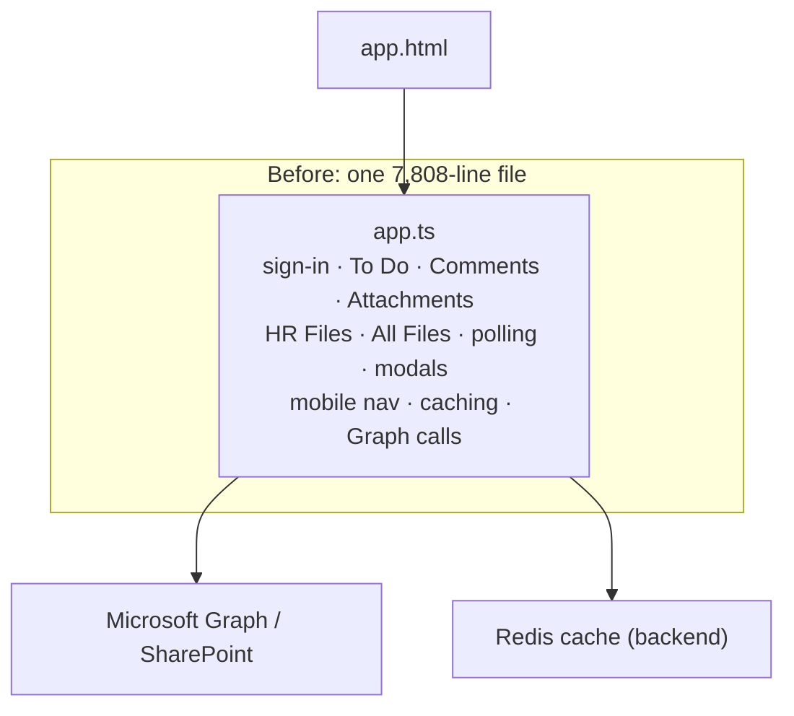

Why that hurts:

| Problem | What it meant day-to-day |
|---|---|
| **Too big to read** | To change the Attachments panel you had to scroll through To Do and HR code you didn't care about. |
| **Everything can touch everything** | Any of 255 methods could change any of 120 fields. A bug in one feature could come from code in another. |
| **Hard to find things** | Section headers were misleading ("FILTER EVENT HANDLERS" was 2,561 lines, mostly To Do loading). |
| **Copied code** | The file list HTML existed twice; the "SharePoint item → file row" mapping existed twice. |
| **Dead code that still ran** | A "prefetch" chain that had been switched off (empty `return;` methods) still ran a timer and emitted events. |

In Next.js terms: it was like putting your whole site – every page, every API call, every piece of state – into one `page.tsx`.

---

## 3. Angular in 5 minutes (only what you need here)

| Angular | You know it as | In this project |
|---|---|---|
| **Component** (`.ts` + `.html` + `.css`) | a React component | `AppComponent`, `AttachmentList`, `PreviewAttachments` |
| **Template** (`.html`) | JSX, but in its own file | `app.html` |
| `{{ value }}` | `{value}` / `<?= $value ?>` | `{{ f.name }}` |
| `[prop]="expr"` | `prop={expr}` | `[files]="attachments.filteredAttachments"` |
| `(event)="fn()"` | `onClick={fn}` | `(click)="attachments.goBackToParent()"` |
| `input()` / `output()` | props / callback props | `file = input<…>()`, `fileSelected = output<…>()` |
| **Service** (`@Injectable`) | a shared module that holds logic/data | `DriveFilesService`, `TaskLoaderService` |
| `inject(X)` | "give me the shared instance of X" | `private driveFiles = inject(DriveFilesService)` |
| **Store** | a service that holds one feature's *state* + the methods that change it | `AttachmentsStore`, `TodoStore` |
| `signal()` | `useState` | `previewFile = signal<DriveFile \| null>(null)` |

Two more ideas you need:

**`providedIn: 'root'` = one shared instance.** Every store and service here is created once for the whole app. When `AppComponent` and `TodoStore` both `inject(CommentsStore)`, they get *the same object* – so they see the same data.

**"Zoneless" and `refreshView()`.** This app runs Angular *without Zone.js*. That means Angular does **not** notice when a normal variable changes after an `await` or a `setTimeout`. The code therefore calls `refreshView()` after changing state, which redraws the screen. (Signals don't need this – see [section 12](#12-what-is-still-left-to-improve).)

---

## 4. Before and after – the big picture

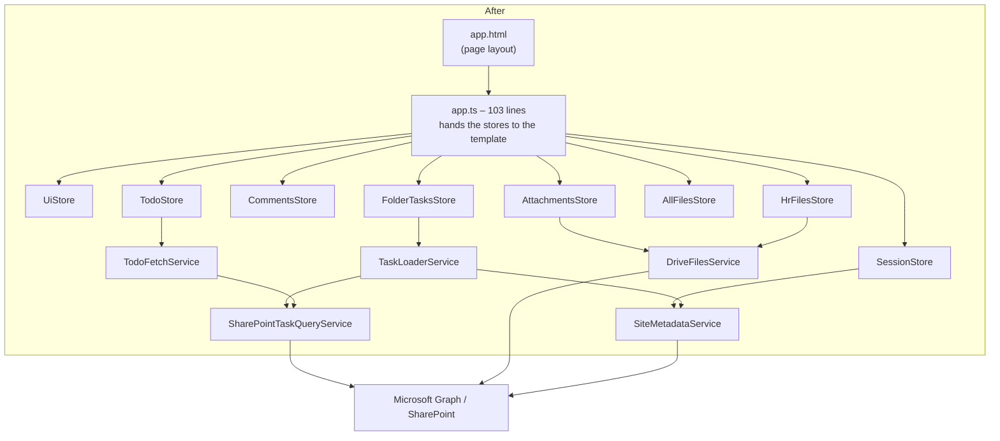

There are now **three layers**, and each layer has one kind of job:

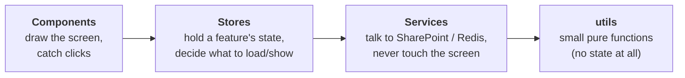

| Layer | Rule | Example |
|---|---|---|
| Component | shows things, forwards clicks | `AttachmentList` draws rows and emits `folderOpened` |
| Store | owns the feature's data, calls services, updates the screen | `AttachmentsStore.openFolder()` loads a folder and sets `userFiles` |
| Service | fetches and converts data, **never** changes the screen | `DriveFilesService.fetchFolderChildren()` returns rows |
| utils | input → output, nothing else | `sortCommentItemsByDateDesc(items)` |

---

## 5. Where everything lives now (folder map)

```
my-app/src/app/
├── app.ts                         ← 103 lines: wiring only
├── app.html                       ← the page layout (uses ui.*, todo.*, comments.* …)
│
├── stores/                        ← NEW: one file per area of the screen
│   ├── view-refresh.service.ts       redraws the screen (refreshView)
│   ├── ui.store.ts                   layout, mobile tabs, menus, modals, refresh button
│   ├── session.store.ts              sign-in, the user, background polling
│   ├── todo.store.ts                 To Do list
│   ├── comments.store.ts             Comments panel + task actions
│   ├── folder-tasks.store.ts         loading a folder's tasks (All Files / HR person)
│   ├── attachments.store.ts          Attachments panel, folders, Back, preview
│   ├── hr-files.store.ts             HR Files + "My Files"
│   └── all-files.store.ts            reacting to All Files clicks
│
├── services/
│   ├── drive-files.service.ts     ← NEW: SharePoint files/folders + preview link
│   ├── task-loader.service.ts     ← NEW: loading HR tasks from many lists
│   ├── todo-fetch.service.ts      ← NEW: To Do list paging (+ its cursors)
│   ├── site-metadata.service.ts      site id / url / lists (now the only copy)
│   ├── sharepoint-task-query.service.ts  low-level list queries
│   └── … (auth, todo, comment, file-crawl cache, etc. – unchanged)
│
├── components/
│   ├── attachments/attachment-list/  ← NEW: the file rows (was copied twice)
│   ├── preview-attachments/          ← NEW: the live file preview
│   └── … (todo-list, All-files, hr-files, … – unchanged)
│
├── models/
│   ├── app-user.model.ts          ← NEW: the signed-in user type
│   └── hr-task-detail.model.ts    ← NEW: task-details panel types
│
└── utils/
    ├── cache-keys.ts              ← NEW: every cache key format in one place
    ├── timing.ts                  ← NEW: sleep()
    ├── hr-task-detail.ts          ← NEW: task-details rows
    ├── comment-utils.ts              (+ sort / due-date helpers moved in)
    └── hr-task-matching.ts           (+ merge / key / list-priority helpers moved in)
```

---

## 6. The feature stores, one by one

Every store is a class with `@Injectable({ providedIn: 'root' })`. Inside, the code is **exactly** what used to be in `app.ts` – only references to *other* features changed from `this.x` to `this.<feature>.x` (for example `this.commentItems` → `this.comments.commentItems`).

| Store | Lines | What it owns | Key methods |
|---|---|---|---|
| **UiStore** | 280 | which section/tab is visible (`showToDoSection`, `mobileCardView`), user menu, modals, PowerApps modal, the refresh button | `onNavItemClick`, `showMobileComments`, `showModal`, `onManualRefresh` |
| **SessionStore** | 423 | `currentUser`, site info, the 10-minute background poll | `checkLoginOnStart`, `loadCurrentUserProfile`, `logout`, `getSharePointToken` |
| **TodoStore** | 1,302 | To Do loading state, selected submitter/eForm, subordinate mode | `loadTodoTasksForCurrentUser`, `onSubmitterSelected`, `loadMoreTodoTasks`, `refreshTodoTasksIncrementally` |
| **CommentsStore** | 985 | `commentItems`, filters, search, paging, the new-comment / eForm / delegate modals | `filteredCommentItems`, `invalidateCommentFilters`, `onCompleteTask`, `openHrTaskForm` |
| **FolderTasksStore** | 1,243 | loading the tasks for an All Files folder or an HR person, Redis caching, prefetch | `loadAllFilesTasksForLibrary`, `loadHrPersonalTasksForFolder`, `loadDocumentLibraryTasksForFolder` |
| **AttachmentsStore** | 796 | `userFiles`, folder stack, search, `previewFile`, HR task-list selector | `openFolder`, `goBackToParent`, `loadDriveFolderContents`, `loadTodoTaskAttachments` |
| **HrFilesStore** | 739 | the people-folder list, "My Files", access group, warm-up | `openHrFileListItem`, `loadHrFilesInFirstSection`, `openMyFiles` |
| **AllFilesStore** | 675 | the folder selected in All Files, ChildSubject dropdown | `onAllFileSelected`, `onAllFilesCommentSelected`, `onAllFilesAttachmentSelected` |
| **ViewRefreshService** | 29 | the batched redraw | `refreshView()` |

### How stores talk to each other

Features really do depend on each other: opening a To Do task must fill **Comments** *and* **Attachments**. So stores call other stores:

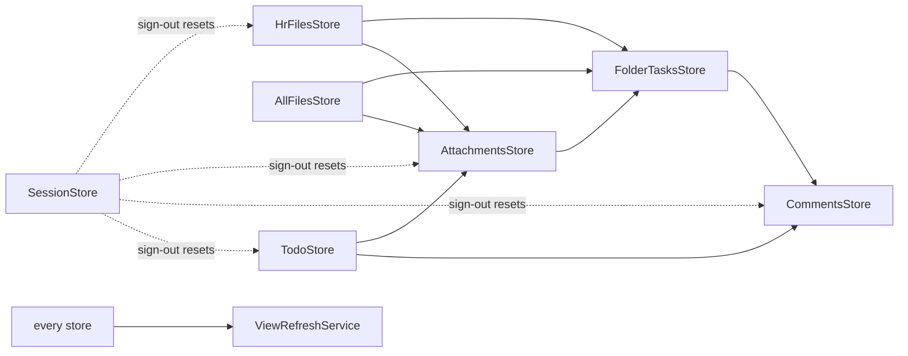

Each store reaches the others through a **lazy getter**:

```ts
private readonly injector = inject(Injector);
private get comments(): CommentsStore { return this.injector.get(CommentsStore); }
```

**Why not just `inject(CommentsStore)` at the top?** Because some stores use each other in a circle (e.g. To Do → Comments → To Do). If both asked for each other *while being created*, Angular would stop with a "circular dependency" error. A getter only asks *when the code actually runs*, by which time both already exist.

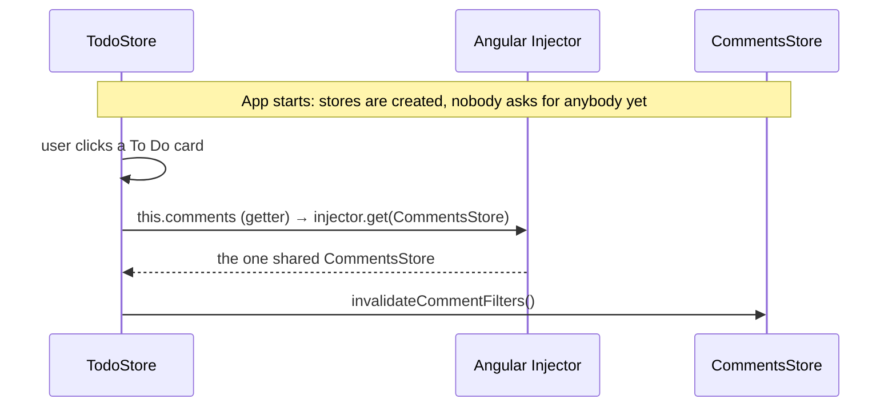

---

## 7. The services and utils

### New services (they never touch the screen)

| Service | Job | Used by |
|---|---|---|
| **DriveFilesService** | list a folder's files (`fetchFolderChildren`), walk a folder tree (`getAllDriveItems`), find the user's personal folder, convert Graph items to rows (`toDriveFile`), get a **preview link** (`getPreviewUrl`) | AttachmentsStore, HrFilesStore, PreviewAttachments |
| **TaskLoaderService** | load an HR person's tasks from many SharePoint lists (`collectHrPersonalTasksFromLists`), choose which lists to ask (`getTaskListsToQuery`), map raw rows (`mapHrFolderRawItems`) | FolderTasksStore, TodoStore |
| **TodoFetchService** | page through To Do lists, remember where each list stopped (cursors, watermarks) | TodoStore |

**How a service reports progress without knowing about the screen** – it receives small functions (callbacks) from the store:

```mermaid
sequenceDiagram
    participant S as FolderTasksStore (screen side)
    participant L as TaskLoaderService (data side)
    participant G as SharePoint
    S->>L: collectHrPersonalTasksFromLists(lists, folder, token, user,<br/>isStale = () => user clicked something else?,<br/>onPartial = (tasks) => show them)
    loop each list
        L->>G: fetch page
        G-->>L: rows
        L->>S: onPartial(tasks so far)
        S->>S: commentItems = tasks; refreshView()
        L->>S: isStale()?
        S-->>L: false → keep going
    end
    L-->>S: all tasks
```

### Things that were cleaned up along the way

| What | Why |
|---|---|
| **One copy of the site info.** `app.ts` kept its own copy of `siteId` / `siteWebUrl` / lists, synced by hand in 4 places. Now only `SiteMetadataService` has it. | Two copies can drift apart. Sign-out now also clears it, so the next user doesn't see the previous user's list of lists. |
| **Deleted a "prefetch" chain that did nothing.** All Files ran a timer and emitted folders; `app.ts` received them in a method that only did `return;`. | Code that runs but does nothing still costs reading time. |
| **Deleted `applyAllFilesFolderSubmitter`.** It returned its input unchanged and was called 6 times. | Same reason. |
| **Merged duplicated code.** The "SharePoint item → file row" mapping existed twice; the file-list HTML existed twice. | Fix a bug once, not twice. |
| **Pure helpers → `utils/`.** e.g. `sortCommentItemsByDateDesc`, `mergeHrTasks`, the cache-key builders. | A function in `utils/` can't secretly depend on component state – what goes in decides what comes out. |
| **Removed orphaned comments** whose functions had already been moved. | They described code that wasn't there. |

---

## 8. How the main screens work now (flowcharts)

### 8.1 App start and sign-in

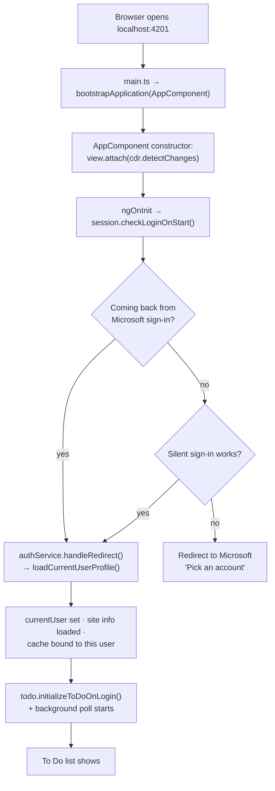

### 8.2 Clicking a task in To Do

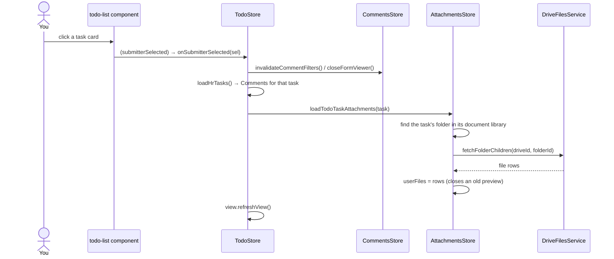

### 8.3 Opening a folder in All Files

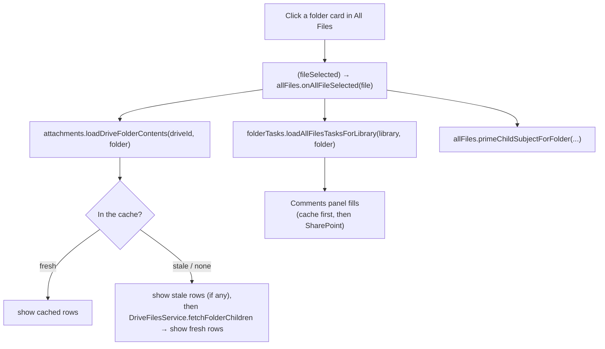

### 8.4 Back button in Attachments

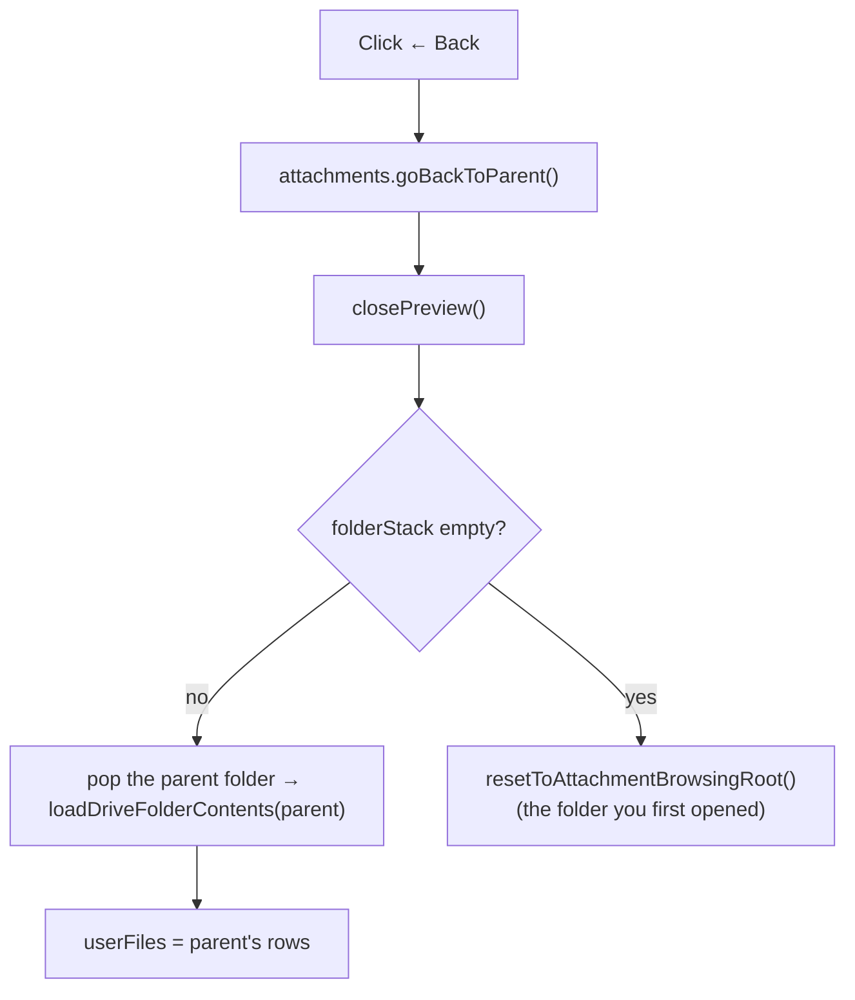

### 8.5 How the screen gets redrawn

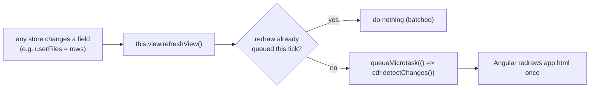

---

## 9. The new attachment preview

**What it does:** rest the mouse on a file for half a second (or click/tap it) and a box under the list shows the real document – Word, Excel, PowerPoint, PDF, images, video.

**How:** Microsoft Graph can give a short-lived "embed" link for any file. We put that link in an `<iframe>`, and **SharePoint's own viewer** draws the file inside it (that's why you see SharePoint's page arrows and zoom).

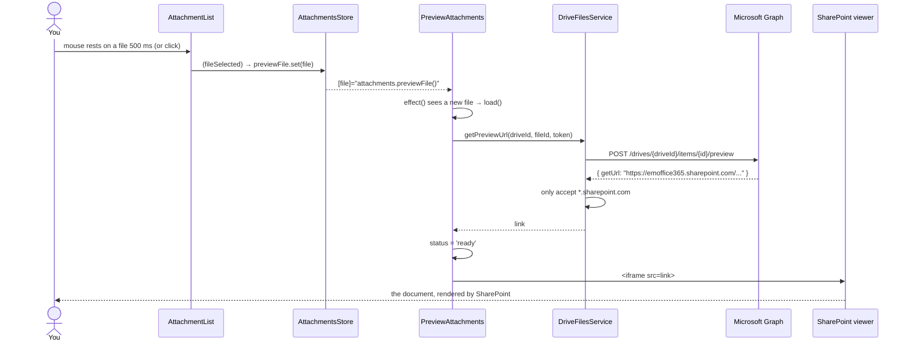

**When it closes:** Back, opening a sub-folder, switching section or mobile tab, or whenever the file list is replaced by a different one (a setter on `userFiles` checks whether the previewed file is still listed).

**Safety:** Angular blocks unknown URLs in iframes. We only allow it (`DomSanitizer.bypassSecurityTrustResourceUrl`) after `DriveFilesService` checked the host ends with `.sharepoint.com`.

**Compared with the Power App:** the Power App showed `Attachments.Selected.Thumbnail` – a *picture* of page 1 in an ``. This shows the *live document* in an `<iframe>`.

---

## 10. How the cleanup was done safely

A 7,800-line file can't be rewritten by hand without breaking something. Four rules made it safe:

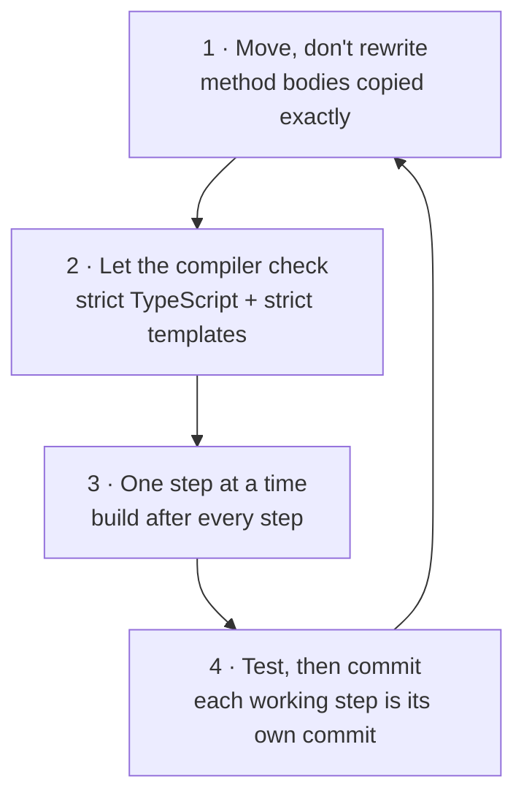

1. **Move, don't rewrite.** Each method was cut and pasted exactly. Only references to *other* features were changed (`this.commentItems` → `this.comments.commentItems`). Rewriting logic while moving it is how bugs sneak in.
2. **Let the compiler check it.** The project uses `strict: true` and `strictTemplates: true`. If a moved method referred to something that is no longer reachable, or a template binding pointed at the wrong store, **the build fails and names the exact line**. ~900 cross-feature references and 250 template bindings were all verified this way.
3. **Small steps, build after each.** Step 0 (dead code, helpers) → Step 1 (services) → Step 2 (stores). A backup of `app.ts` was kept before each step.
4. **Test, then commit.** Each step that worked became its own commit, so any step can be undone on its own (`git revert <commit>`).

The moves themselves were done with small scripts (cut method → rewrite references → paste → fix callers) so that nothing was retyped.

### The steps in order

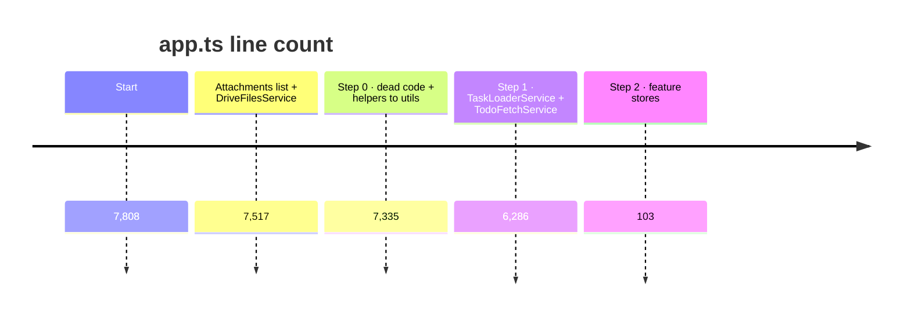

---

## 11. "I want to change X – which file?"

| I want to… | Open |
|---|---|
| change how a file row looks | `components/attachments/attachment-list/attachment-list.html` |
| change the preview box | `components/preview-attachments/preview.*` |
| change what happens when a folder is opened / Back | `stores/attachments.store.ts` (`openFolder`, `goBackToParent`) |
| change how To Do loads or pages | `stores/todo.store.ts`, paging in `services/todo-fetch.service.ts` |
| change Comments filters / search / "Load more" | `stores/comments.store.ts` (`filterCommentItems`, `filteredCommentItems`) |
| change which SharePoint lists are queried | `services/task-loader.service.ts` (`getTaskListsToQuery`) |
| change how an All Files click behaves | `stores/all-files.store.ts` |
| change HR Files / My Files | `stores/hr-files.store.ts` |
| change sign-in / sign-out / polling | `stores/session.store.ts` |
| change mobile tabs, menus, modals | `stores/ui.store.ts` |
| change a cache key | `utils/cache-keys.ts` |
| change the page layout | `app.html` (state is read as `todo.x`, `comments.x`, `attachments.x` …) |

**Tip:** in VS Code press `Ctrl+P` and type the file name, or `Ctrl+Shift+F` and search for the method name.

---

## 12. What is still left to improve

`app.ts` is minimal, but the **stores** still carry the old style. Next steps, in order of value:

| Next step | Why | Effort |
|---|---|---|
| **Signals instead of `refreshView()`** – turn store fields into `signal()`s | The screen updates by itself; 126 `refreshView()` calls disappear; fewer "why didn't it redraw?" bugs | medium, store by store |
| **Split the two biggest stores** (`todo.store.ts` 1,302 lines, `folder-tasks.store.ts` 1,243) | e.g. To Do loading vs To Do paging; HR folder tasks vs library folder tasks | medium |
| **Replace `any` with interfaces** (task, comment card, list item) | the editor can tell you what a variable contains | ongoing |
| **Panel components** (`CommentsPanel`, `AttachmentsPanel`) that inject their store directly | `app.html` shrinks to layout only | medium |
| **Tests for the stores** | a store with no screen is easy to test | ongoing |
| **`SwiftPaperless-upload/` → `.gitignore`** | it's a build output folder, not source | 1 minute |

---

## 13. Glossary

| Word | Meaning |
|---|---|
| **Component** | A piece of screen: a class + an HTML template + CSS. |
| **Template** | The HTML of a component, with Angular bindings (`{{ }}`, `[ ]`, `( )`). |
| **Service** | A class Angular creates once and shares; holds logic/data, no HTML. |
| **Store** | A service that owns one feature's state and the methods that change it. |
| **`inject()`** | Ask Angular for the shared instance of a service/store. |
| **Dependency Injection (DI)** | Angular creating services and handing them to whoever asks. |
| **Circular dependency** | A needs B to be created and B needs A – solved here with lazy getters. |
| **Lazy getter** | `get x() { return injector.get(X); }` – only looks X up when used. |
| **Zoneless** | Angular without Zone.js: you must tell it to redraw (here `refreshView()`). |
| **Signal** | A value Angular watches; changing it redraws automatically. |
| **Microsoft Graph** | Microsoft's web API for SharePoint, OneDrive, users… |
| **Drive / driveItem** | A SharePoint document library / a file or folder in it. |
| **iframe** | A window showing another web page inside yours. |
| **Pure function** | Same input → same output, touches nothing else. Lives in `utils/`. |
| **God component** | One component that does every job in the app. What `app.ts` was. |

---

## 14. Commit history of this work

| Commit | What |
|---|---|
| `d865f42` | Attachments cleanup (`AttachmentList`, `DriveFilesService`), file preview, Step 0 (dead prefetch chain, no-op helper, pure helpers → utils) |
| `d5eddad` | Step 1: `TaskLoaderService`, `TodoFetchService`, site info from `SiteMetadataService`, cache keys / sleep / merge helpers → utils |
| *(this commit)* | Step 2: feature stores – `app.ts` 6,286 → 103 lines; types moved to `models/`; this document |

To see exactly what changed in a step: `git show <commit> --stat`, or open the commit on GitHub.
