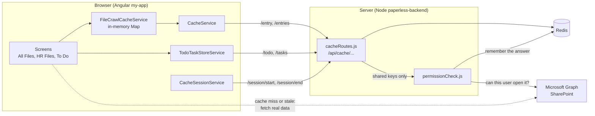
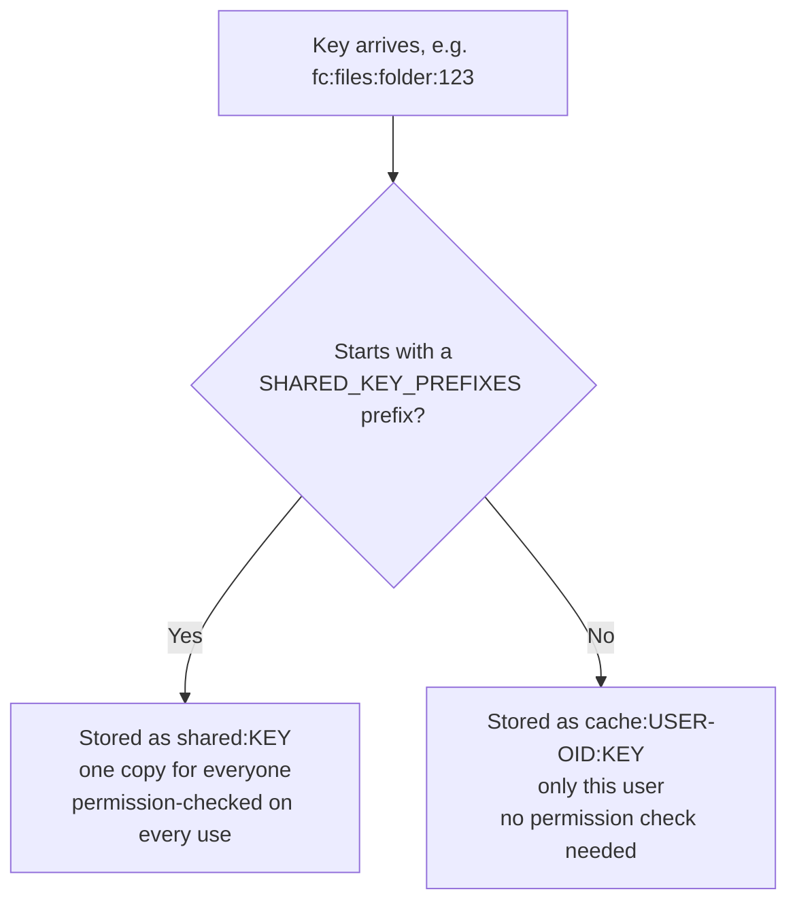
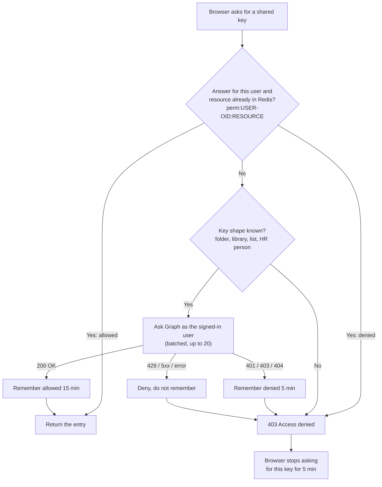
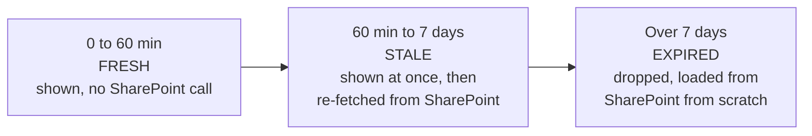
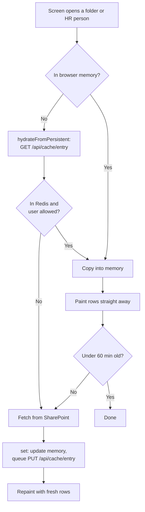
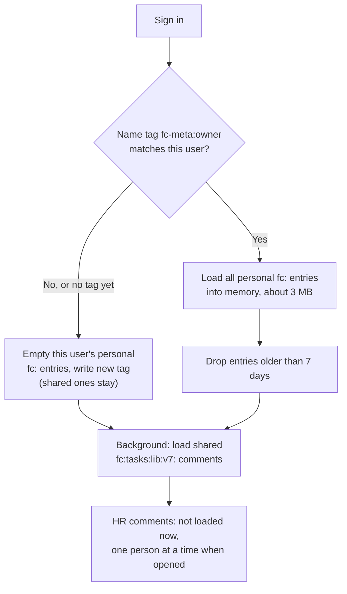
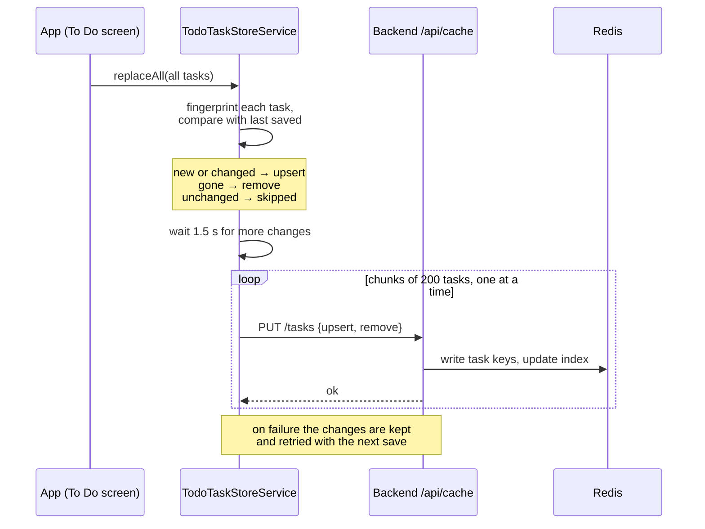
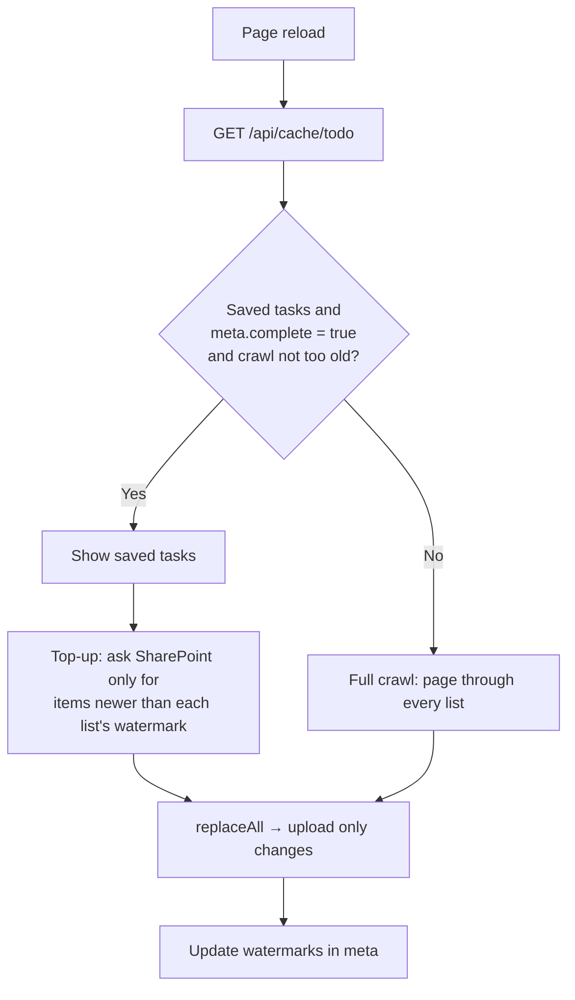
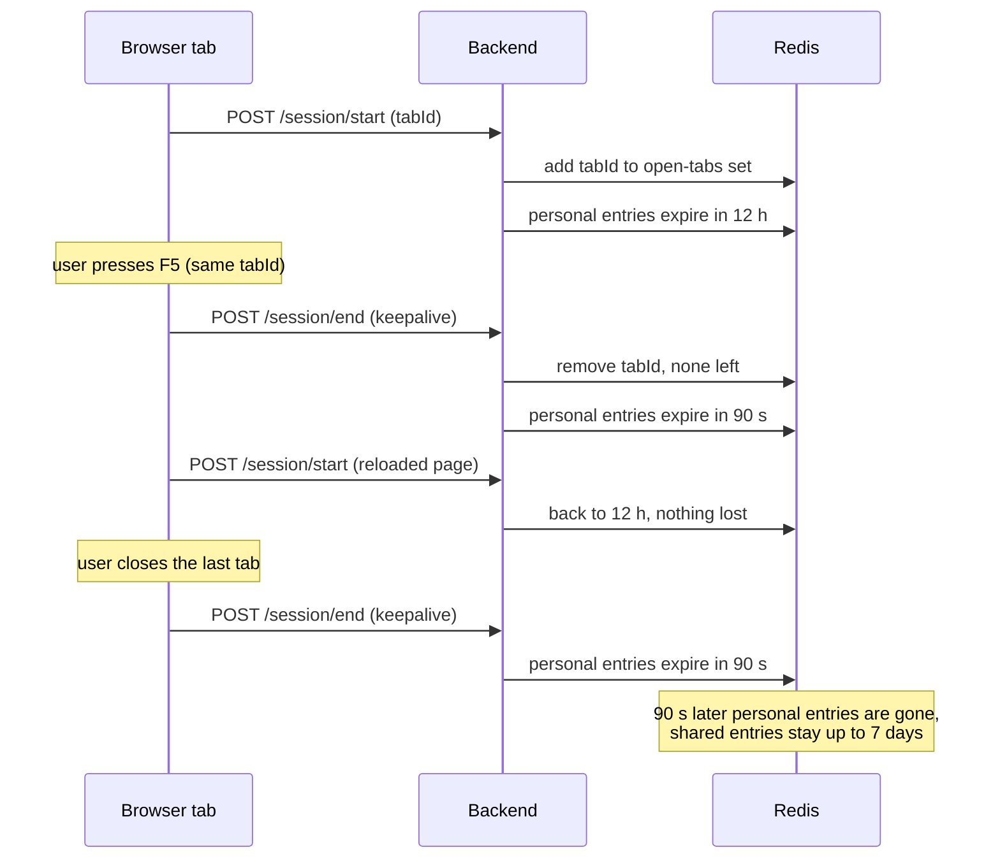

# Paperless – How the Redis cache works today

This document describes what is **already built** in the Paperless app (Angular `my-app` + Node `paperless-backend`). It does not propose changes.

Sources read: `paperless-backend/cacheRoutes.js`, `permissionCheck.js`, `redisClient.js`, and in `my-app/src/app/services/`: `cache.ts`, `cache-session.service.ts`, `file-crawl.service.ts`, `todo-task-store.service.ts`, plus `components/hr-files/hr-files.component.ts`.

**Not read / not verified:** `app.ts` (where the refresh and load flow is wired up), `subordinaryTask.service.ts`, and the other services. Anything about what happens exactly on a browser refresh is partly inferred from the cache code. The app was not run.

---


## 1. Redis in simple terms

Redis is a very fast notepad that lives on the **server**, not in the browser. When the app needs something slow to get (SharePoint folders, comments, tasks), it saves a copy in Redis. Next time, it reads the saved copy instead of asking SharePoint again.

Two important things follow from that:

- Redis is **shared by default**. It is not tied to one browser or device. Whether data is private or shared depends on how the key is named.
- The browser still has to **call your backend** to read from Redis. Redis reduces calls to SharePoint/Graph, not calls from the browser to your server.

---


## 2. The pieces


| Piece                                                 | Where   | Job                                                                                             |
| ----------------------------------------------------- | ------- | ----------------------------------------------------------------------------------------------- |
| `redisClient.js`                                      | backend | Connects to Redis (`REDIS_URL`, default `redis://localhost:6379`)                               |
| `cacheRoutes.js`                                      | backend | The `/api/cache/...` endpoints the browser calls to read/write/delete cache entries             |
| `permissionCheck.js`                                  | backend | Decides whether a user may read a **shared** cache entry                                        |
| `cache.ts` (`CacheService`)                           | browser | Thin client for the `/api/cache` endpoints (get/set/clear/by prefix)                            |
| `file-crawl.service.ts` (`FileCrawlCacheService`)     | browser | In-memory cache in front of Redis for files/comments; decides fresh vs stale                    |
| `todo-task-store.service.ts` (`TodoTaskStoreService`) | browser | Separate To Do cache, one Redis entry per task                                                  |
| `cache-session.service.ts` (`CacheSessionService`)    | browser | Tells the backend which tabs are open, so personal entries can expire after the last tab closes |


There are therefore **two layers**: an in-memory copy in the browser (lost on refresh) and Redis on the server (survives refresh).



**In plain words:** think of a library with a front desk.

- **SharePoint** is the big archive in the basement. It has everything, but going down there is slow.
- **Redis** is a shelf of photocopies next to the front desk. Much faster to grab.
- **The backend** (`cacheRoutes.js`) is the librarian at the desk. The browser never touches the shelf directly. It always asks the librarian.
- **`permissionCheck.js`** is the librarian checking your badge before handing over a photocopy of something that belongs to everyone.
- **The browser memory** (`FileCrawlCacheService`) is the photocopy you already have in your hand. It's the fastest of all, but you drop it when you refresh the page.

> **Example:** You open the "Contracts" folder in All Files. The app first looks in its own memory. If the folder isn't there, it asks the backend, which checks Redis. Only if Redis has no copy, or the copy is too old, does the app go all the way to SharePoint.

The dotted line means the browser talks to SharePoint directly when it needs real, up-to-date data. The cache only saves those trips. It doesn't replace them.

---


## 3. Shared vs personal entries

Every key is stored in one of two namespaces:

- **Shared:** `shared:<key>`, one copy for all users and browsers.
- **Personal:** `cache:<userOid>:<key>`, where `userOid` is the user's Entra object id. Only that user can read or wipe it.

The backend treats a key as shared only if it starts with one of these prefixes (`SHARED_KEY_PREFIXES`):


| Prefix                | What it holds                                              |
| --------------------- | ---------------------------------------------------------- |
| `fc:files:folder:`    | All Files folder listings                                  |
| `fc:files:lib:`       | All Files library root listings (one per document library) |
| `fc:tasks:lib:v7:`    | All Files folder comments                                  |
| `fc:tasks:hr-folder:` | HR Files per-person comments                               |


Everything else is personal, for example the user's To Do tasks and `fc:tasks:hr-user:…` (My Tasks, per assignee).



**In plain words:** every saved item has a name (the "key"), like a label on a box. The backend reads the start of the label to decide which shelf the box goes on: the **shared** shelf everyone can use, or the user's **own locked drawer**.

**Why shared?** One person's crawl warms the cache for everybody, so the second person does not have to wait for SharePoint.

> **Example:** Anna opens the "Contracts" folder at 9:00. Nothing is cached yet, so the app loads it from SharePoint (slow) and saves a copy on the shared shelf. Ben opens the same folder at 9:05 and gets Anna's copy from Redis almost instantly.

### How the code knows if a key is shared

The browser doesn't decide this. The backend does, with one small check in `cacheRoutes.js`:

```js
const SHARED_KEY_PREFIXES = [
  'fc:files:folder:',
  'fc:files:lib:',
  'fc:tasks:lib:v7:',
  'fc:tasks:hr-folder:',
];

const isSharedKey = (key = '') =>
  SHARED_KEY_PREFIXES.some((prefix) => String(key).startsWith(prefix));

const ns = (req, key = '') => {
  if (key && isSharedKey(key)) return `shared:${key}`;
  return `cache:${req.userOid}:${key}`;
};
```

- `isSharedKey` asks: does the key **start with** one of the four words in the list? If yes, it's shared. If no, it's personal.
- `ns` ("namespace") then builds the real name the key gets inside Redis.

> **Examples** (for a user whose id is `abc-123`):
>
> | The browser sends the key | Starts with a shared prefix? | Saved in Redis as |
> |---|---|---|
> | `fc:files:folder:drive1:item42` | Yes (`fc:files:folder:`) | `shared:fc:files:folder:drive1:item42` |
> | `fc:tasks:hr-folder:John Smith` | Yes (`fc:tasks:hr-folder:`) | `shared:fc:tasks:hr-folder:John Smith` |
> | `fc:tasks:hr-user:anna@company.com` | No | `cache:abc-123:fc:tasks:hr-user:anna@company.com` |
> | `todo:task:Leave:15` | No | `cache:abc-123:todo:task:Leave:15` |

So "shared or not" depends only on the label. To make a new kind of data shared, a developer has to add its prefix to `SHARED_KEY_PREFIXES` on purpose. Anything new is personal by default, which is the safe choice.

### Why personal keys need no permission check

A personal key always has the user's own id baked into its name (`cache:<userOid>:…`). The important part is **where that id comes from**:

1. When the browser calls the backend, it sends the user's Microsoft sign-in token.
2. `authMiddleware.js` checks that the token is real: signed by Microsoft, for this app, from your company's tenant. If it isn't, the request is rejected with 401.
3. The backend reads the user's id (`oid`) **out of that verified token** and stores it as `req.userOid`.

The browser never says "I am user abc-123". It can only show its token, and the backend works out the id from that. So when Ben's browser asks for `todo:task:Leave:15`, the backend turns it into `cache:<Ben's id>:todo:task:Leave:15`. There's no way for Ben to point at Anna's drawer, because he can't put Anna's id in the name.

That's why personal keys skip the SharePoint check (`canUseKey` lets them straight through). The data was uploaded by that same user, and only that user can ever reach it.

Shared keys are different: everyone's requests point at the **same** `shared:…` entry, so the label alone can't protect it. That's what the permission check in the next section is for.

---


## 4. How permissions are protected on shared entries

Because shared data is visible to everyone in Redis, the backend checks SharePoint permissions **every time** a shared key is read, written or deleted (`canUseKey` → `canAccessKey` in `permissionCheck.js`).

How the check works:

1. The backend calls Microsoft Graph **as the signed-in user** (on-behalf-of token).
2. Each shared key is mapped to the SharePoint object that guards it:
  - folder listing → that drive item
  - library root listing → that document library (must be one of the user's visible drives)
  - folder comments (`fc:tasks:lib:…`) → that SharePoint list
  - HR person comments (`fc:tasks:hr-folder:…`) → that person's folder in the HR library
3. Graph is asked (batched, up to 20 at a time) whether the user can open that object. Success means allowed; 401/403/404 means denied.
4. The answer is remembered in Redis: **15 minutes** for "allowed", **5 minutes** for "denied" (`perm:<userOid>:<resource>`).
5. If the backend cannot verify (Graph error, unknown key shape, rate limit), it **denies** (fail closed). Temporary errors (429/5xx) are denied but not cached.



**In plain words:** before handing out a shared photocopy, the librarian asks the archive (SharePoint): "Would *this person* be allowed to open the original?" If the answer is yes, they get the copy. If it's no, or the librarian can't find out, they get nothing.

The trick is that the backend doesn't keep its own list of who can see what. It simply **asks SharePoint while pretending to be the user**, and SharePoint answers using the permissions you already set up there.

#### Step by step: how a permission check is made

**Step 1. Work out which SharePoint object protects the key.** `describeKey` in `permissionCheck.js` looks at the shape of the key and decides what to test:

| Key looks like | Protected by | What the backend asks Graph to open |
|---|---|---|
| `fc:files:folder:<driveId>:<itemId>` | That folder | `/drives/<driveId>/items/<itemId>` |
| `fc:files:lib:<site>:<libraryName>` | That document library | `/drives/<driveId>/root`, but only if the library is in the user's list of visible libraries |
| `fc:tasks:lib:v7:<listName>:…` | That SharePoint list | `/sites/<siteId>/lists/<listName>` |
| `fc:tasks:hr-folder:<personName>` | That person's folder in the HR library | `/drives/<hrDriveId>/root:/<personName>` |
| anything else | nothing known | not asked, **denied** |

**Step 2. Check the memo first.** Earlier answers are saved in Redis as `perm:<userOid>:<resource>`, holding `1` for yes or `0` for no. If an answer is there, it's used straight away and Graph isn't called.

**Step 3. Ask Microsoft Graph as the user.** For anything not in the memo, the backend swaps the user's token for a Graph token "on behalf of" that user (`getGraphClient(req.userToken)`). Then it tries to open each object. It sends up to 20 questions in one go (Graph `$batch`) to save time.

**Step 4. Read the answer.**

- `200 OK`: SharePoint let the user open it, so the answer is **allowed**. Remembered for 15 minutes.
- `401`, `403` or `404`: SharePoint refused, or the item is hidden from them, so the answer is **denied**. Remembered for 5 minutes.
- `429` (too many requests), `5xx` (server error), or the call fails: the backend can't be sure, so it **denies** but doesn't remember it. The next request tries again.

**Step 5. Hand out only what's allowed.** For `GET /entry`, the user either gets the entry or a 403. For `GET /entries`, the user gets the list with the forbidden entries quietly removed.

> **Example 1: allowed.** Anna works in HR. She opens John Smith's HR folder. The key is `fc:tasks:hr-folder:John Smith`. The backend asks Graph, as Anna, to open `HRPersonal/John Smith`. SharePoint says 200 because Anna has HR access. She gets the cached comments, and for the next 15 minutes the backend won't ask again.
>
> **Example 2: denied.** Ben works in Finance. He somehow requests the same key, maybe from an old link or by editing a request. The backend asks Graph, as Ben, to open `HRPersonal/John Smith`. SharePoint says 403 because Ben has no HR access. Ben gets "Access denied", even though the data is sitting right there in Redis.
>
> **Example 3: Graph is down.** Microsoft has an outage and Graph answers 503. The backend can't confirm, so it refuses. This is called **fail closed**: when in doubt, say no. Ben and Anna both see SharePoint loading instead of cached data until Graph recovers.

Results for list endpoints (`GET /entries`) are filtered, so a user only receives entries for folders and lists they can open.

Consequence: if someone loses access, they can still read the shared snapshot for up to about 15 minutes (the cached "allowed" answer).

> **Example:** At 10:00 Anna's access to HR is removed in SharePoint. The backend remembered "Anna allowed" at 9:50, so until about 10:05 she can still see cached HR comments. After that the memo expires, Graph says 403, and she's locked out.

The browser side also remembers a 403 for a key for 5 minutes (`DENIED_RETRY_MS`) so it does not keep asking.

---


## 5. Backend endpoints (`/api/cache`)


| Endpoint                  | What it does                                                                                                                                                 |
| ------------------------- | ------------------------------------------------------------------------------------------------------------------------------------------------------------ |
| `GET /entry?key=`         | Read one entry (`{ data, timestamp }` or null). Shared keys: permission-checked. Falls back to an old personal copy if the shared one is missing             |
| `PUT /entry`              | Write one entry. Shared keys: permission-checked, 7-day expiry. Personal keys: 12-hour expiry. Removes the old personal copy of a key once it becomes shared |
| `DELETE /entry?key=`      | Delete one entry                                                                                                                                             |
| `GET /entries?prefix=`    | All entries starting with a prefix (shared ones filtered by permission)                                                                                      |
| `DELETE /entries?prefix=` | Delete by prefix. **Empty prefix wipes only this user's personal keys** (used on logout)                                                                     |
| `POST /session/start`     | A tab announces itself; restores the normal expiry on the user's personal entries                                                                            |
| `POST /session/end`       | A tab says goodbye; if none are left, personal entries get a short expiry                                                                                    |
| `GET /todo`               | This user's whole To Do cache                                                                                                                                |
| `PUT /tasks`              | Save changed To Do tasks and remove deleted ones                                                                                                             |
| `DELETE /todo`            | Forget this user's whole To Do cache                                                                                                                         |


---


## 6. Expiry times at a glance


| What                                       | Time              | Where it is set             |
| ------------------------------------------ | ----------------- | --------------------------- |
| Shared entries in Redis                    | 7 days            | `ENTRY_TTL_SECONDS`         |
| Personal entries in Redis                  | 12 hours          | `PERSONAL_TTL_SECONDS`      |
| Personal entries after the last tab closes | 90 seconds        | `SESSION_END_GRACE_SECONDS` |
| Permission answer "allowed"                | 15 minutes        | `ALLOW_TTL`                 |
| Permission answer "denied"                 | 5 minutes         | `DENY_TTL`                  |
| Browser treats a snapshot as "fresh"       | 60 minutes        | `CACHE_TTL` (file crawl)    |
| Browser drops a saved snapshot at sign-in  | older than 7 days | `PERSIST_MAX_AGE`           |
| To Do counts as "fresh"                    | 60 minutes        | `FRESH_FOR_MS`              |
| Browser remembers a 403                    | 5 minutes         | `DENIED_RETRY_MS`           |


The first three can be changed with environment variables (`CACHE_ENTRY_TTL_SECONDS`, `CACHE_PERSONAL_TTL_SECONDS`, `CACHE_SESSION_GRACE_SECONDS`).

How old a file or comment snapshot can be, and what the app does with it:



**In plain words:** like milk in the fridge. Fresh milk you just drink. Milk that's a bit old you still use, but you buy a new carton on the way home. Milk past the date goes in the bin, and you have to go to the shop before you can have any.

> **Example:** The "Contracts" folder was saved at 9:00.
>
> - Open it at **9:30** (30 min old, **fresh**): it appears instantly, and SharePoint isn't asked at all.
> - Open it at **11:00** (2 hours old, **stale**): the old list appears instantly so you're not staring at a spinner. In the background the app asks SharePoint, and a second later the list updates if anything changed.
> - Open it **next week** (over 7 days, **expired**): Redis has already thrown it away, so you see a loading screen while it comes from SharePoint.

---


## 7. Files and comments (All Files, HR Files)

Handled by `FileCrawlCacheService`, which keeps an in-memory `Map` in front of Redis.

**Reading**

- `get(key)` returns data only if it is less than 60 minutes old. Otherwise it returns null, which tells the caller to re-fetch from SharePoint.
- `getStale(key)` returns data of any age, for an instant first paint while a fresh fetch runs.
- `hydrateFromPersistent(key)` pulls **one key** from Redis into memory when memory misses. It returns the data plus whether it is still fresh. This is how HR person snapshots and shared folder listings load, one at a time, when a screen needs them.

What happens when a screen opens a folder or an HR person:



**In plain words:** the app looks for the data in three places, from fastest to slowest, and stops at the first one that has it:

1. **Its own memory.** Instant, but empty after a refresh.
2. **Redis**, through the backend. Very fast, and it includes the permission check for shared data.
3. **SharePoint.** Always correct, but slow.

Whatever it finds, it **shows straight away**. Only then does it ask "is this too old?" If it is, it quietly fetches from SharePoint, saves the new copy for next time (in memory and in Redis), and updates the screen.

> **Example:** Ben refreshes the page, then clicks HR Files → "Maria Borg".
>
> 1. Memory is empty because of the refresh.
> 2. The app asks the backend for `fc:tasks:hr-folder:Maria Borg`. The backend checks Ben may see Maria's folder, finds a copy Anna saved 3 hours ago, and returns it.
> 3. Ben sees Maria's comments immediately.
> 4. 3 hours is over 60 minutes, so the app also asks SharePoint. One new comment was added since then, so the list refreshes with it and the new copy is saved to Redis for the next person.

**Writing**

- `set(key, data)` writes to memory and queues a write to Redis (writes run one after another, after sign-in loading has finished).
- `CacheService.set` skips the upload if the content is identical to the last one stored for that key (a fingerprint check), and gzips bodies over 8 KB.
- `setMemoryOnly` is used for payloads too big for Redis. The All Files comments search index is never saved to Redis because it is too large (HTTP 413). It lives in memory only and is rebuilt after a refresh.
- If a save fails with 413, the old Redis copy is deleted so a stale copy is not shown on the next visit.

**Invalidating**

- `invalidate(key)`: delete from memory and Redis (after upload/delete/rename).
- `expire(key)`: mark as needing a refresh without deleting. `get()` misses, but `getStale()` still shows the old rows meanwhile, and the shared Redis copy stays for other users until the fresh `set()` overwrites it.
- `clearAll()`: used on logout.

**Sign-in (**`bindToUser`**)**

1. Reads the name tag (`fc-meta:owner`) stored among the user's own personal entries.
2. If the tag is missing or doesn't match the signed-in name, the user's personal `fc:` entries are deleted and a new tag is written. Shared ones are left alone.
3. If it is the same user, all personal `fc:` entries are loaded into memory (this is roughly a 3 MB download, per a code comment). Entries older than 7 days are dropped.
4. The shared `fc:tasks:lib:v7:` entries are then loaded in the background, without blocking the first paint.
5. HR comments (`fc:tasks:hr-folder:`) are **not** bulk-loaded. A code comment says they total about 200 MB across all HR people, and bulk-loading blocked sign-in for 10+ seconds and used about 500 MB of memory. They are pulled one person at a time.



**In plain words:** when you sign in, the app looks in **your own personal drawer** in Redis for a small name tag (`fc-meta:owner`) that says who the saved items were made for. If the tag matches you, your saved items are loaded into memory so the app feels instant. If the tag is missing or doesn't match, the drawer is emptied and a fresh tag with your name is written. Then the shared comments load in the background so the screen isn't held up. HR comments are far too big to load all at once, so they wait until you actually open a person.

Your drawer is already locked to your Microsoft account id (see section 3), so another person can never see it. The name tag is an extra tidy-up step: it makes sure the drawer never contains leftovers that weren't made for the name you're signed in with.

> **Examples:**
>
> - **Ben signs in for the first time.** His drawer has no name tag yet. It doesn't match, so the drawer is emptied (there's nothing in it anyway) and a tag saying "Ben" is written. His data then fills up from SharePoint as he uses the app.
> - **Ben signs in again later that day.** The tag says "Ben", which matches, so all his saved personal items load at once. That's about 3 MB, and the app is fast straight away.
> - **Ben switches to a different account without reloading the page.** The browser memory still holds Ben's items, so it's cleared first. Then the check above runs for the new account.
> - In every case, the HR comments for all staff are **not** downloaded at sign-in. Only when Ben clicks "Maria Borg" is her one entry fetched.

**HR Files screen (**`hr-files.component.ts`**)**
This component only displays the list it is given (search, sort, paging 100 at a time). It paints names from the last saved copy of the domain-user list first (`peekUsers`), then updates when fresh data arrives. The actual loading of HR folders is done by the parent (`app.ts`).

---


## 8. To Do cache

Handled by `TodoTaskStoreService` and the `/todo` and `/tasks` endpoints. It is separate from the file cache because the old single To Do snapshot grew too large for the upload limit and had to be re-sent in full after every change.

**How it is stored (personal, never shared)**

- `cache:<oid>:todo:task:<list>:<id>`: one entry per task
- `cache:<oid>:todo:index`: a Redis set listing this user's task keys
- `cache:<oid>:todo:updated`: when the To Do was last saved
- `cache:<oid>:todo:meta`: bookkeeping for top-ups (see below)

All of these sit under `cache:<oid>:`, so logout's "clear all" wipes them too. They are personal on purpose, because the browser uploads these rows.

**Only changed tasks are uploaded**
`replaceAll(items)` fingerprints every task and compares it to what Redis already has. Only tasks that are new or changed are queued as `upsert`, and tasks that disappeared as `remove`. Saves are debounced (1.5 seconds), sent in chunks of 200 tasks (the backend allows at most 500 per call), and run one after another so a delete can never overtake an earlier upload. If a save fails, the changes are put back and retried with the next change.

So if child 1 changes, only child 1 is uploaded. The parent and child 2 are untouched. (Whether a parent has values calculated from its children was not checked.)



**In plain words:** every task gets a short "fingerprint", a code made from its contents. If anything in the task changes, the fingerprint changes too. Before saving, the app compares today's fingerprints with the ones it saved last time, and only uploads tasks whose fingerprint is different. It also waits 1.5 seconds first, so that if you change three things quickly they go up in one trip instead of three.

> **Example:** You have 300 tasks in To Do. You change the due date of one leave request.
>
> - 299 fingerprints match, so they're skipped.
> - 1 fingerprint differs, so that one task is uploaded.
> - A task that was completed by someone else and has dropped off your list is sent as a "remove".
>
> Without fingerprints, all 300 tasks would be uploaded every time.

Uploads go one batch at a time, in order. That way a "remove" sent later can never arrive before an "upsert" sent earlier and bring a deleted task back.

**Top-ups instead of full reloads (**`meta`**)**
The saved `meta` holds:

- `watermarks`: the newest `lastModifiedDateTime` seen for each SharePoint list
- `complete`: whether the last full crawl finished, so the saved tasks are the whole set
- `crawledAt`: when that crawl finished

On reload, the app can ask SharePoint only for items newer than each watermark, instead of paging every list again. Old crawls are redone, because a top-up cannot see lists that were empty at the time. A top-up also does not notice deleted items.



**In plain words:** a "watermark" is a bookmark that says "I've read everything up to here". For each SharePoint list, the app remembers the time of the newest task it has seen. On the next reload it only asks for tasks changed **after** that time, instead of re-reading the whole list.

> **Example:** Yesterday at 17:00 the app read all 2,000 tasks in the "Leave" list. The newest one was changed at 16:45, so the watermark is 16:45.
>
> This morning you reload. The app shows yesterday's 2,000 tasks from Redis straight away, then asks SharePoint: "Leave items changed after 16:45?" SharePoint returns 3 tasks. Only those 3 are added or updated.

**Limits to know:**

- If a task was **deleted** in SharePoint, a top-up won't notice, because it only asks for "changed after". A full crawl fixes that.
- If the last full crawl didn't finish (`complete = false`) or is too old, the app does a full crawl instead of a top-up.

**Loading**
`load()` pulls the user's To Do from Redis once per session and is safe to call repeatedly. `getAll()` returns tasks of any age, and `getFresh()` returns them only if saved within the last hour. If SharePoint answers before Redis, the SharePoint list is kept and the store works out what Redis needs.

**Forgetting**
`invalidate()` clears the in-memory copy and calls `DELETE /todo`, which removes this user's whole To Do cache.

Each task is its own Redis key (`cache:<oid>:todo:task:<list>:<id>`). In `todo-task-store.service.ts`, `replaceAll()` fingerprints every task and uploads only the ones that changed (`PUT /tasks` with `upsert` and `remove`). Updating child 1 uploads child 1 only.

---


## 9. Tab lifetime of personal entries (`CacheSessionService`)

Goal: personal data should not sit in Redis long after the user has left.

- Each tab gets an id stored in `sessionStorage`. A **refresh keeps the same id**; a new tab gets a new one.
- On load, the tab calls `POST /session/start`. The backend adds the tab id to a set and puts the normal 12-hour expiry back on all the user's personal entries.
- When the page goes away (`pagehide`, unless it is going into the back/forward cache), the tab calls `POST /session/end` using `keepalive` so the request outlives the page.
- If **no tabs are left**, all the user's personal entries are set to expire in **90 seconds**. That grace period is long enough for a refresh (the old page says goodbye, the reloaded page says hello) not to lose anything.
- If a tab crashes without saying goodbye, the entries still expire at the 12-hour limit at the latest.
- **Shared entries are never touched** by this logic.



**In plain words:** each open tab checks in with the backend ("I'm here") and checks out when it goes away ("I'm leaving"). The backend keeps a list of your open tabs. When the list becomes empty, your personal saved data gets a 90-second countdown. If a tab checks back in before the countdown ends, the countdown is cancelled.

Why 90 seconds? Because pressing **F5** looks exactly like "close the tab, open it again". The old page checks out, and a moment later the reloaded page checks in. The 90 seconds is a safety gap so a refresh never wipes your data.

> **Examples:**
>
> - **You press F5.** The tab checks out, the countdown starts, and about 2 seconds later the reloaded tab checks in. The countdown is cancelled and nothing is lost.
> - **You have two tabs open and close one.** One tab is still in the list, so no countdown starts.
> - **You close the browser and go to lunch.** The last tab checks out, and 90 seconds later your personal saved data is deleted from Redis. When you come back, it rebuilds from SharePoint. Shared folder copies are still there, so All Files is still fast.
> - **Your laptop crashes.** The tab never checks out, so there's no countdown. Your data is still removed at the 12-hour limit at the latest.

Result: a refresh keeps personal data in Redis. Closing every tab and coming back after more than about 90 seconds starts personal data from scratch. Shared data stays for up to 7 days.

---


## 10. Typical flows

**First visit of the day**

1. Sign in. `bindToUser` loads personal `fc:` entries from Redis into memory (or empties them if the name tag is missing or doesn't match).
2. Shared comments for lists load in the background.
3. When the user opens a folder or HR person, that one key is fetched from Redis via the backend (permission-checked). A hit paints immediately. If the snapshot is older than 60 minutes, SharePoint is queried too and the result is saved back.
4. On a Redis miss, the data comes from SharePoint and is saved to Redis for everyone who may open it.

**Browser refresh**

1. The in-memory copy disappears.
2. The tab keeps its id, so personal entries in Redis stay.
3. Sign-in loading runs again: personal entries are re-downloaded and shared keys are re-fetched one at a time as screens need them. (Inferred. The exact order in `app.ts` was not read.)
4. Data older than 60 minutes is re-fetched from SharePoint, while old rows are shown meanwhile.

**Editing something (upload, delete, rename, update a task)**

- Files: the affected key is invalidated or expired, and the next load repopulates it.
- To Do: only the changed task is uploaded.

**Logout**

- Memory is cleared, and `DELETE /entries` with an empty prefix removes the user's personal Redis entries. Shared entries remain.

---


## 11. Summary of what exists vs what does not

**Exists**

- Shared, permission-checked cache for All Files and HR Files, with fail-closed permission checks.
- Personal, per-user cache for To Do and similar.
- Per-task To Do storage with changed-only uploads.
- To Do top-ups using per-list watermarks.
- Stale-while-refresh painting (`getStale`), 60-minute freshness, and 7-day maximum age.
- Tab-based expiry of personal entries with a 90-second grace period.
- Upload savings: identical-content skip, gzip over 8 KB, denied-key memory.

**Does not exist (yet)**

- A browser-side persistent cache (the app used IndexedDB before, then moved to Redis).
- Delta updates for files and comments; they are replaced as whole snapshots.
- A way for deletions to be noticed by To Do top-ups.
- Persistence of the All Files comments search index.

